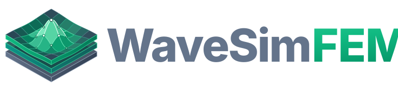

<div align="center">



### A GPU-Accelerated Finite Element Framework for Acoustic and Elastic Wave Propagation in Layered Media

[](https://www.python.org/downloads/)
[](https://fenicsproject.org/)
[](https://petsc.org/)
[](https://cupy.dev/)
<br>
[](https://pypi.org/project/wavesimfem/)
[](https://github.com/ductho-le/WaveSimFEM/actions/workflows/tests.yml)
[](https://github.com/ductho-le/WaveSimFEM/blob/main/LICENSE)
[](https://doi.org/10.5281/zenodo.24423592)

[Quick Start](#-quick-start) •
[Examples](#-ready-to-run-examples) •
[Capabilities](#-what-you-can-simulate) •
[Configuration](#%EF%B8%8F-create-your-own-model) •
[Documentation](#-documentation) •
[Discussions](https://github.com/ductho-le/WaveSimFEM/discussions) •
[Citation](#-citation)

</div>

---

## 💡 What is WaveSimFEM?

**WaveSimFEM** lets you simulate how acoustic, ultrasonic, and seismic waves propagate, reflect, attenuate, and couple across layered media — **from Hz-scale earth structures to MHz-scale plates and tissues — without writing finite element code**.

Describe your layers, material properties, wave source, and virtual sensors in a plain YAML file, run one command, and obtain waveforms, B-scans, frequency–wavenumber ($f$–$k$) dispersion spectra, and optional 2D wavefield animations. Under the hood, it runs on [DOLFINx](https://fenicsproject.org/), [PETSc](https://petsc.org/), and optional [CuPy](https://cupy.dev/) GPU acceleration.

```text
1. YAML Config  ──▶  2. Run `wavesim`  ──▶  3. Data (.npz) + Plots + 2D Wave Animations
  (your model)        (CPU, MPI, GPU)         (waveforms, B-scans, f–k, ParaView .bp)
```

### ✨ Why Use WaveSimFEM?

- **No FEM boilerplate**: Define geometry, materials, sources, and sensors in readable YAML files.
- **Multi-physics layered media**: Model isotropic metals, anisotropic composites, viscoelastic tissues, acoustic fluids, and coupled fluid–solid systems.
- **Fast on any hardware**: Run on a single laptop CPU, scale across CPU cores with MPI, or accelerate on NVIDIA GPUs with CUDA.
- **Safe defaults & preflight checks**: Preview mesh size, time step, and RAM usage (`--dry-run`) before running, with automatic stability checks so explicit runs do not blow up.
- **Built-in signal analysis & wave animations**: Record virtual sensor arrays for waveforms, B-scans, and $f$–$k$ dispersion plots, and optionally export full 2D wavefield snapshots (`.bp`) for smooth animations in ParaView.

---

## 🚀 Quick Start

### Step 1 — Install

WaveSimFEM uses Conda (`conda-forge`) to install the DOLFINx / PETSc / MPI finite element stack cleanly on **Linux** and **macOS**:

```bash
git clone https://github.com/ductho-le/WaveSimFEM.git
cd WaveSimFEM
conda env create -f environment.yml
conda activate wavesim
pip install -e .
```

Already inside a DOLFINx 0.10.0 Conda or Docker environment? Install directly from PyPI:

```bash
pip install wavesimfem
```

*(Optional)* Add NVIDIA GPU support (CUDA 12.x):

```bash
pip install "wavesimfem[cuda]"   # or: pip install -e ".[cuda]" from source
```

<details>
<summary><b>💡 macOS note (only if you see an Xcode linker error)</b></summary>

If you hit `unknown architecture arm64e` during first-run compilation, prefix the command with Apple's system compiler:

```bash
CC=/usr/bin/clang LDSHARED="/usr/bin/clang -bundle -undefined dynamic_lookup" \
  wavesim -c configs/01_plate_aluminum_lamb.yaml --no-usetex
```

</details>

### Step 2 — Run Your First Simulation

Start with Example 01 (a 1 MHz Lamb wave in a 3 mm aluminum plate):

```bash
# 1. Check mesh size and estimated RAM before running (takes ~1 second)
wavesim -c configs/01_plate_aluminum_lamb.yaml --dry-run

# 2. Run the simulation and generate plots (--no-usetex avoids needing LaTeX installed)
wavesim -c configs/01_plate_aluminum_lamb.yaml --no-usetex
```

When it finishes, open `results_01_plate_aluminum_lamb/full_analysis.png` to inspect the recorded waveforms, B-scan, and $f$–$k$ dispersion plot.

> [!TIP]
> Want to run faster on a multi-core CPU or NVIDIA GPU?
> - **4 CPU cores (MPI)**: `sh tools/run_cpu4.sh -c configs/01_plate_aluminum_lamb.yaml --no-usetex`
> - **NVIDIA GPU**: `wavesim -c configs/01_plate_aluminum_lamb.yaml --device cuda --no-usetex`

### Step 3 — Replot or Load Results in Python

Change frequency/wavenumber plot limits anytime without re-running the solver:

```bash
wavesim --postprocess results_01_plate_aluminum_lamb/sensor_data.npz \
  --f-max "2 MHz" --k-max "3 rad/mm" --no-usetex
```

Or load the saved sensor data directly in Python:

```python
import numpy as np

with np.load("results_01_plate_aluminum_lamb/sensor_data.npz", allow_pickle=False) as data:
    times = data["times"]  # Time vector [s]
    sensor_x = data["sensor_x"]  # Sensor positions along x [m]
    u_y = data["sensor_data_y"]  # Vertical displacement [m] (fluid cases use sensor_data_pressure)

print(f"Recorded {u_y.shape[1]} sensors over {len(times)} time steps.")
```

> [!NOTE]
> Prefer a guided walkthrough? Open [`notebooks/quickstart.ipynb`](https://github.com/ductho-le/WaveSimFEM/blob/main/notebooks/quickstart.ipynb) for an interactive 5-minute demo.

---

## 📚 Ready-to-Run Examples

Pick the example closest to your application under [`configs/`](https://github.com/ductho-le/WaveSimFEM/blob/main/configs/README.md) and adapt it:

| Example | Structure | Physics & Application | Source |
| :--- | :--- | :--- | :--- |
| [`01 · Aluminum plate`](https://github.com/ductho-le/WaveSimFEM/blob/main/configs/01_plate_aluminum_lamb.yaml) | 3 mm isotropic plate | Lamb waves & NDE/SHM inspection | 1 MHz Ricker |
| [`02 · CFRP composite`](https://github.com/ductho-le/WaveSimFEM/blob/main/configs/02_plate_cfrp.yaml) | 8-ply `[0/90/0/90]_s` laminate | Anisotropic guided-wave dispersion | 1 MHz Ricker |
| [`03 · Steel halfspace`](https://github.com/ductho-le/WaveSimFEM/blob/main/configs/03_halfspace_steel_rayleigh.yaml) | Truncated elastic half-space | Rayleigh surface waves | 1 MHz Ricker |
| [`04 · Soil over bedrock`](https://github.com/ductho-le/WaveSimFEM/blob/main/configs/04_plate_on_halfspace_soil_bedrock.yaml) | 10 m soil layer on bedrock | Seismic surface-wave dispersion | 15 Hz Ricker |
| [`05 · Cortical bone`](https://github.com/ductho-le/WaveSimFEM/blob/main/configs/05_layers_bone_qus.yaml) | Soft tissue / bone / marrow | Viscoelastic axial-transmission ultrasound | 500 kHz Ricker |
| [`06 · Immersed plate`](https://github.com/ductho-le/WaveSimFEM/blob/main/configs/06_plate_in_halfspaces_immersed_water.yaml) | Aluminum plate in water | Leaky Lamb & Scholte waves | 1 MHz Ricker |
| [`07 · Water channel`](https://github.com/ductho-le/WaveSimFEM/blob/main/configs/07_fluid_acoustic.yaml) | Acoustic water cavity | Pure acoustic pressure waves | 1 MHz Ricker |
| [`08 · Coupled fluid–solid`](https://github.com/ductho-le/WaveSimFEM/blob/main/configs/08_fluid_solid_acoustic.yaml) | Aluminum plate on water | Fluid–structure interaction | 1 MHz Ricker |

---

## 🌍 What You Can Simulate

The 8 configs above are just starting points — mix any layer stack, material law, source, boundary, and sensor array to model wave physics from Hz-scale geophysics to MHz ultrasonics:

- **NDE & Composites**: Lamb modes ($A_0, S_0$, higher-order), narrowband tone-burst tuning, anisotropic CFRP dispersion, bonded/coated plates, and immersed leaky Lamb waves.
- **Acoustics & Fluid–Solid Coupling**: Pressure waveguides, cavity resonances, oblique fluid–solid reflection/transmission, and Scholte / quasi-Scholte interface waves.
- **Biomedical Ultrasound**: Axial-transmission guided waves in layered tissue/bone/marrow with Kelvin–Voigt viscoelastic attenuation.
- **Geophysics & Seismology**: Bulk $P$/$SV$ arrivals, Rayleigh surface waves, dispersive soil-over-bedrock profiles, and synthetic shot gathers.
- **Data Generation & Inversion**: Reproducible parameter sweeps producing waveform, dispersion, and 2D wavefield datasets for inverse modeling and ML.

---

## 🛠️ Create Your Own Model

Generate a fully commented starter file with:

```bash
wavesim --generate-config my_model.yaml
```

All numeric inputs use standard SI units (`m`, `s`, `Hz`, `Pa`, `kg/m³`). Here is a complete, minimal example:

```yaml
solver:
  type: explicit
  CFL: 0.8

structure:
  mode: 1_layer
  single_layer:
    name: aluminum
    thickness: 3.0e-3          # 3 mm thick plate
    rho: 2700.0                # Density [kg/m^3]
    E: 70.0e9                  # Young's modulus [Pa]
    nu: 0.33                   # Poisson's ratio

geometry:
  sensing_length: 0.10         # 100 mm observation zone
  absorb_length: 0.03          # 30 mm absorbing edges to suppress reflections

mesh:
  nx: 320                      # Elements along x
  ny_per_region: [12]          # Elements through thickness (bottom-to-top)
  degree: 2                    # Quadratic (Q2) elements

excitation:
  source_type: ricker
  f_center: 1.0e6              # 1 MHz center frequency
  traction_max: 1.0e6
  source_fy: -1.0              # Downward normal force

sensors:
  n_sensors: 64
  sensor_offset: 5.0e-3        # Distance from source to first sensor [m]
  sensor_pitch: 1.0e-3         # 1 mm spacing between sensors

output:
  write_vtx: false             # Set true to export 2D wavefield snapshots for ParaView animations
  target_snapshots: 200        # Number of animation frames when write_vtx is true
```

*Need more options? See [`configs/template.yaml`](https://github.com/ductho-le/WaveSimFEM/blob/main/configs/template.yaml) for every available setting.*

---

## 📁 Output Artifacts

Every run saves a self-contained folder with data, settings, and plots:

- **`sensor_data.npz`**: Recorded waveforms, timestamps, sensor positions, units, and run metadata.
- **`simulation_config.yaml`**: Exact resolved settings and runtime provenance (mesh, $\Delta t$, versions).
- **`full_analysis.png`** / **`.pdf`**: Multi-panel summary with waveforms, B-scan, and $f$–$k$ dispersion.
- **`wave_physics/`**, **`lamb_modes/`**, **`characterisation/`** *(optional)*: Structure-specific dispersion references, $A_0$/$S_0$ Lamb mode separation, and packet velocity/attenuation reports.
- **`*.bp/`** *(optional, set `output.write_vtx: true`)*: Full 2D wavefield time-series snapshots (`guided_wave.bp`, `solid_displacement.bp`, `acoustic_pressure.bp`) for interactive visualization and wave animations in [ParaView](https://www.paraview.org/).

### 🎬 Creating 2D Wavefield Animations

To visualize the full 2D propagating wavefield (and export `.mp4` / `.gif` animations):

1. In your YAML config under `output:`, set `write_vtx: true` and choose the frame count with `target_snapshots` (default `200`; increase for smoother playback).
2. Run `wavesim -c your_config.yaml` as usual — snapshots are saved to `guided_wave.bp/` (elastic runs) or `solid_displacement.bp/` and `acoustic_pressure.bp/` (coupled/acoustic runs).
3. Open the `.bp` folder in **[ParaView](https://www.paraview.org/)** (`ADIOS2VTXReader`), click **Apply**, press **Play** to animate the wave propagation, or use **File → Save Animation** to export a video.

---

## ⚙️ Advanced Guides

<details>
<summary><b>CLI Flags & Execution Backends (CPU, GPU, MPI, Implicit, SLURM)</b></summary>

```bash
wavesim -c configs/01_plate_aluminum_lamb.yaml --device cpu              # Single CPU core
wavesim -c configs/01_plate_aluminum_lamb.yaml --device cuda             # NVIDIA GPU (CuPy)
mpiexec -n 4 wavesim -c configs/01_plate_aluminum_lamb.yaml --device cpu # Multi-core MPI
mpiexec -n 4 wavesim -c configs/01_plate_aluminum_lamb.yaml --solver implicit
```

| Flag | Description |
| :--- | :--- |
| `-c`, `--config PATH` | YAML, TOML, or JSON configuration file |
| `--generate-config PATH` | Create a commented starter YAML file (`--force` to overwrite) |
| `--dry-run` | Print mesh, DOF, $\Delta t$, and memory estimates without running |
| `--solver {explicit,implicit}` | Explicit RK4 (default) or implicit Newmark-β |
| `--device DEV` | `auto`, `cpu`, `cuda`, or `cuda:N` |
| `--precision {double,single}` | Precision for the single-process explicit solver |
| `--output DIR` | Custom output directory |
| `--postprocess NPZ` | Re-run analysis on an existing `sensor_data.npz` |
| `--no-postprocess` | Skip figure generation |
| `--f-min`, `--f-max`, `--k-min`, `--k-max Q` | Dispersion plot limits (SI or unit string, e.g., `"2 MHz"`, `"3 rad/mm"`) |
| `--duration S`, `--dt S`, `--cfl F` | Override duration, max time step, or CFL factor |
| `--usetex` / `--no-usetex` | Enable or disable external LaTeX rendering (default: disabled) |
| `-q` / `-v` / `--version` | Quiet output, verbose debug logs, or print version |

**Minimal SLURM GPU script:**

```bash
#!/bin/bash
#SBATCH --job-name=wavesim_gpu
#SBATCH --gres=gpu:1
#SBATCH --cpus-per-task=4
#SBATCH --mem=16G
#SBATCH --time=01:00:00

source activate wavesim
wavesim -c configs/08_fluid_solid_acoustic.yaml --device cuda --no-usetex
```

</details>

<details>
<summary><b>Supported Physics, Materials & Boundaries</b></summary>

- **Layer layouts**: `1_layer`, `N_layers`, `halfspace`, `plate_on_halfspace`, `plate_in_halfspaces` (bottom-to-top).
- **Materials**: `isotropic`, `anisotropic` (`[C11, C12, C16, C22, C26, C66]`), `viscoelastic` (Kelvin–Voigt `C` and `Cv`), and inviscid acoustic `fluid` (`rho`, `c` or `K`).
- **Sources**: Solid `traction`, or fluid `acoustic_pressure`, `acoustic_normal_acceleration`, and `acoustic_volume`, using `ricker` or Hann-windowed `tone_burst` pulses.
- **Boundaries**: Absorbing sponges on lateral/half-space edges; `rigid`, `pressure_release`, or `radiation` conditions on exterior fluid faces.
- **Observables**: `displacement` / `velocity` in solids; `pressure` / `particle_velocity` in fluids (`auto` picks the natural observable).

</details>

<details>
<summary><b>Python API Quickstart</b></summary>

```python
import wavesimfem as ws

# 1. Load config & inspect preflight estimate
cfg = ws.parse_and_resolve_config("configs/01_plate_aluminum_lamb.yaml")
estimate = ws.preflight_estimate(cfg)
print(f"Estimated DOFs: {estimate['ndofs_est']:,} | Steps: {estimate['nsteps_est']:,}")

# 2. Run simulation
archive_path, out_dir = ws.run_simulation(cfg=cfg)

# 3. Generate figures and reports
ws.plot_full_analysis(archive_path, output_dir=out_dir, f_max=2.0e6, k_max=3000.0, usetex=False)
ws.write_structure_report(archive_path, output_dir=out_dir, usetex=False)
```

</details>

<details>
<summary><b>Troubleshooting</b></summary>

- **Missing LaTeX error**: Pass `--no-usetex` (or set `output.usetex: false` in YAML) to use Matplotlib's built-in math fonts without installing TeX.
- **`--device cuda` fails**: Make sure `cupy-cuda12x` matches your NVIDIA driver/CUDA version; explicit `--device cuda` exits with code `3` instead of silently falling back to CPU.
- **MPI hangs or libfabric warnings on Linux**: Set `export FI_PROVIDER=tcp` and `export OMP_NUM_THREADS=1`.

</details>

<details>
<summary><b>Testing & Verification (for Developers)</b></summary>

WaveSimFEM is verified against analytical dispersion relations (Lamb, Rayleigh, Scholte modes), acoustic cavity resonances, and transmission benchmarks:

```bash
python -m pytest                     # Full local test suite
python -m pytest -m "not slow"       # Fast subset
python tools/verify_acoustics.py --case all
```

Pushes and PRs run lightweight CI ([`tests.yml`](https://github.com/ductho-le/WaveSimFEM/blob/main/.github/workflows/tests.yml): lint, pure-Python/array tests, and distribution smoke checks). The full Python 3.11/3.12 DOLFINx + MPI + LaTeX matrix runs weekly, on release tags, and on demand via `gh workflow run tests.yml -f full_tests=true`.

</details>

---

## 🗂️ Project Structure

```text
WaveSimFEM/
├── src/wavesimfem/    # Core package (CLI, configs, elastic/acoustic solvers, GPU/MPI, analysis)
├── configs/           # Annotated template.yaml and 8 flagship example configurations
├── notebooks/         # Interactive quickstart notebook
├── tools/             # Benchmarks, acoustic verification, and release/packaging utilities
├── tests/             # Serial, MPI, acoustic, GPU, and release test suites
├── environment.yml    # Conda-forge environment specification
├── pyproject.toml     # Packaging, pytest, coverage, and Ruff configuration
├── CHANGELOG.md       # Semantic version history
└── CITATION.cff       # Machine-readable citation metadata
```

---

## 📖 Documentation

- [Configuration & Physics Guide](https://github.com/ductho-le/WaveSimFEM/blob/main/configs/README.md) — detailed discretization, material, and verification reference
- [Full YAML Template](https://github.com/ductho-le/WaveSimFEM/blob/main/configs/template.yaml) — every parameter documented inline
- [Quickstart Notebook](https://github.com/ductho-le/WaveSimFEM/blob/main/notebooks/quickstart.ipynb) — interactive end-to-end walkthrough
- [Changelog](https://github.com/ductho-le/WaveSimFEM/blob/main/CHANGELOG.md) · [Contributing](https://github.com/ductho-le/WaveSimFEM/blob/main/.github/CONTRIBUTING.md) · [Security Policy](https://github.com/ductho-le/WaveSimFEM/blob/main/.github/SECURITY.md)

---

## 📜 Citation

If you use WaveSimFEM in your research, please cite:

```bibtex
@software{le2026wavesimfem,
  author    = {Le, Ductho},
  title     = {{WaveSimFEM}: A {GPU}-accelerated finite element framework for acoustic and elastic wave propagation in layered media},
  year      = {2026},
  publisher = {Zenodo},
  doi       = {10.5281/zenodo.24423592},
  url       = {https://doi.org/10.5281/zenodo.24423592}
}
```

Or in APA format:
> Le, D. (2026). *WaveSimFEM: A GPU-accelerated finite element framework for acoustic and elastic wave propagation in layered media* [Computer software]. Zenodo. https://doi.org/10.5281/zenodo.24423592

*Machine-readable citation metadata is available in [`CITATION.cff`](https://github.com/ductho-le/WaveSimFEM/blob/main/CITATION.cff).*

---

## 📄 License

Licensed under the [MIT License](https://github.com/ductho-le/WaveSimFEM/blob/main/LICENSE).

---

<div align="center">

**[Ductho Le](mailto:ductho.le@outlook.com)** · School of Biomedical Engineering, International University – VNU HCMC

[](https://orcid.org/0000-0002-3073-1416)
[](https://scholar.google.ca/citations?user=OlwMr9AAAAAJ)
[](https://www.researchgate.net/profile/Ductho-Le)

</div>
